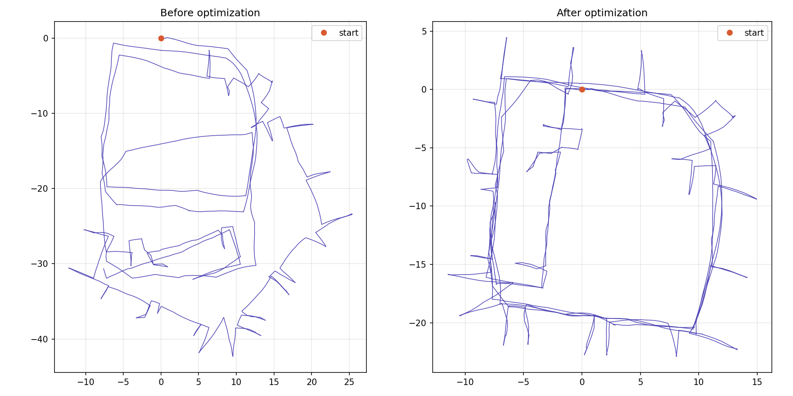

# 2D 位姿图优化（GTSAM）

用 C++ 和 GTSAM 从零实现的 2D 位姿图优化，在经典的 Intel 实验室数据集上运行。机器人只靠里程计推算出的轨迹会逐渐漂移，加入回环约束并做非线性最小二乘优化后，轨迹被拉回一致，恢复出实验室的走廊结构。



## 结果

| | 优化前 | 优化后 |
|---|---|---|
| 总误差 | 3.72 × 10⁶ | 76.6 |
| 迭代次数 | — | 5 |

数据集包含 1228 个位姿和 1483 条测量（其中包括回环约束）。优化后误差不为 0，是因为真实测量之间存在矛盾，所有约束无法同时被完全满足。

## 方法

- 每个位姿是一个 `Pose2`（x, y, θ），作为因子图中的变量；
- 每条测量是一个 `BetweenFactor<Pose2>`，表示两个位姿之间的相对运动；
- 在第一个位姿上加一个先验因子，消除整张图平移、旋转的自由度；
- 以数据集中的位姿作为初始估计，用 Levenberg-Marquardt 算法优化。

## 环境依赖

- Ubuntu 24.04（在 Windows 的 WSL2 中测试）
- g++ 13、CMake 3.28
- GTSAM 4.3.0（从源码编译安装）
- Python 3 与 matplotlib（仅用于画图）

## 数据准备

数据文件不包含在本仓库中，按以下步骤下载并处理：

```bash
mkdir -p data
curl -L -o data/intel.g2o "https://www.dropbox.com/s/vcz8cag7bo0zlaj/input_INTEL_g2o.g2o?dl=1"
awk '$1=="EDGE_SE2"{$7=100;$8=0;$9=0;$10=100;$11=0;$12=400} {print}' data/intel.g2o > data/intel_uniform.g2o
```

**为什么要处理数据：** 原始文件中部分测量的信息矩阵不正定，另有一些方向的权重相差数千倍，直接优化时线性方程组无法求解，迭代次数为 0。上面的 `awk` 命令把每条测量的信息矩阵统一替换为对角矩阵，对应位置标准差 0.1 m、角度标准差 0.05 rad。

## 编译与运行

```bash
cmake -S . -B build
cmake --build build
./build/pose_graph_2d [g2o文件路径]
python3 scripts/plot_traj.py
```

程序会在项目根目录生成 `result_init.csv` 和 `result_opt.csv`（列为 `id,x,y,theta`），画图脚本读取它们并生成 `compare.png`。

## 项目结构

```
pose_graph_2d/
├── CMakeLists.txt
├── src/main.cpp            # 读数据、加先验、优化、导出结果
├── scripts/plot_traj.py    # 画优化前后对比图
├── docs/compare.png        # README 中的结果图
└── data/                   # 数据文件（不上传，见“数据准备”）
```

## 数据来源与致谢

- 数据集：Intel Research Lab（西雅图），原始数据由 Dirk Hähnel 采集，可在 http://www.ipb.uni-bonn.de/datasets/ 获取；
- g2o 格式文件来自 Luca Carlone 的数据集页面：https://lucacarlone.mit.edu/datasets ；
- 按数据集页面的要求，引用：L. Carlone and A. Censi. From Angular Manifolds to the Integer Lattice: Guaranteed Orientation Estimation With Application to Pose Graph Optimization. *IEEE Transactions on Robotics*, 30(2):475–492, 2014.
- 优化库：[GTSAM](https://github.com/borglab/gtsam)。
